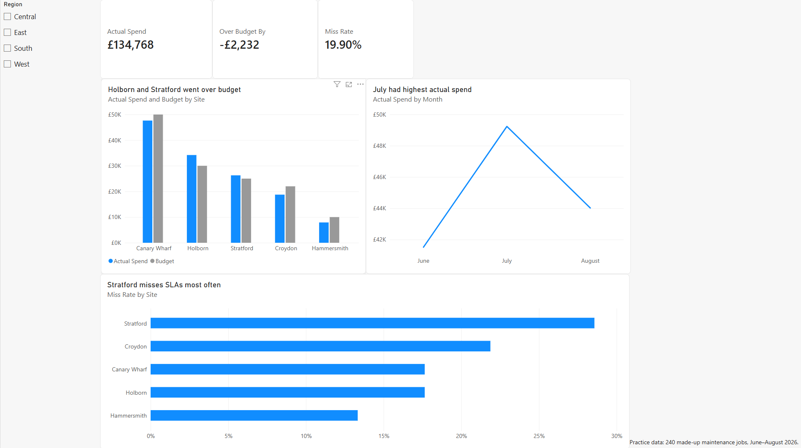

# Facilities Maintenance Dashboard (Power BI)

A one-page Power BI dashboard that answers a facilities manager's question: how are five London office sites doing on maintenance cost and SLAs?



**Practice data:** 240 made-up maintenance jobs across five London sites, June to August 2026. The data is synthetic and was built for practice. It is not real data from any company.

## The data

- **Jobs** is the fact table. It has one row per maintenance job: date raised, site, category, priority, status, cost, labour hours, and whether the job met its SLA.
- **Sites** is the dimension table. It has one row per site: site manager, region, and the June to August budget.
- The two tables are joined on Site in a one-to-many relationship (a star schema), so filters flow from Sites to Jobs.

## Measures (DAX)

```
Actual Spend   = SUM(Jobs[Cost (£)])
Budget         = SUM(Sites[Budget Jun–Aug (£)])
Over Budget By = [Actual Spend] - [Budget]
SLA Misses     = CALCULATE(COUNTROWS(Jobs), Jobs[SLA Met] = "No")
Completed Jobs = CALCULATE(COUNTROWS(Jobs), Jobs[Status] = "Completed")
Miss Rate      = DIVIDE([SLA Misses], [Completed Jobs])
```

## Findings

- **Holborn and Stratford went over budget.** Holborn went £4,198 over its £30,000 budget. Its July spend was £16,898. In July, its HVAC alone cost £8,116, against £3,208 in June and nothing in August. If July's HVAC had cost the same as June's, Holborn's total would have been £29,290, which is £710 under budget. Stratford went £1,275 over its £25,000 budget. Its August spend was £12,535, while June was £7,612 and July was £6,128. Unlike Holborn, its main contributor was the increase in job volume in August: 21 jobs, compared with 8 in July and 14 in June.
- **July had the highest actual spend.** July cost £49,237, the most of any month, mainly because of Holborn's HVAC spike.
- **Stratford had the highest SLA miss rate.** Its miss rate was 28.57%: it had 10 SLA misses out of 35 completed jobs. Canary Wharf had the most misses, at 12, but it also had the most completed jobs, at 68, so its rate was lower, at 17.65%.

## Design choices

- The Region slicer filters every visual, because Region comes from the dimension table.
- There is no Month slicer. The budget covers all three months, so comparing a single month's spend against it would make every site look under budget.
- Miss Rate is SLA misses divided by completed jobs. Open and in-progress jobs haven't met or missed their SLA yet, so they are left out.
- Chart titles state the finding rather than the topic.

## Files

- `Maintenance_Dashboard.pbix`: the Power BI report. Open it with Power BI Desktop, which is free.
- `Maintenance_Practice_Data.xlsx`: the source data.
- `overview.png`: a screenshot of the Overview page.

## Tools

Power BI Desktop and DAX. The same analysis was first done in Excel with pivot tables, XLOOKUP, SUMIFS and COUNTIFS, and the two sets of results were checked against each other.
